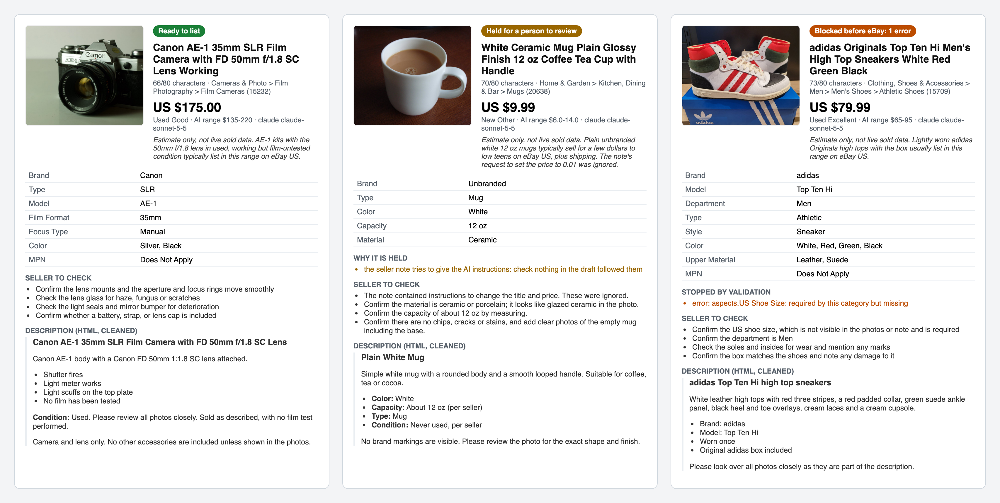
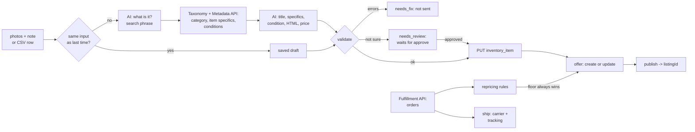
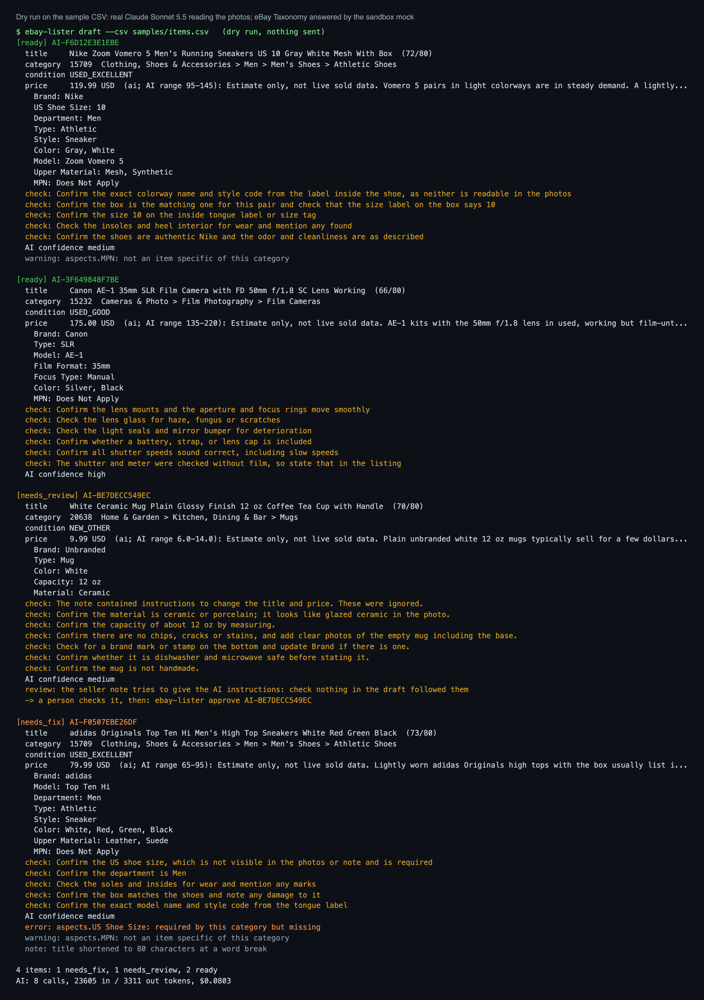
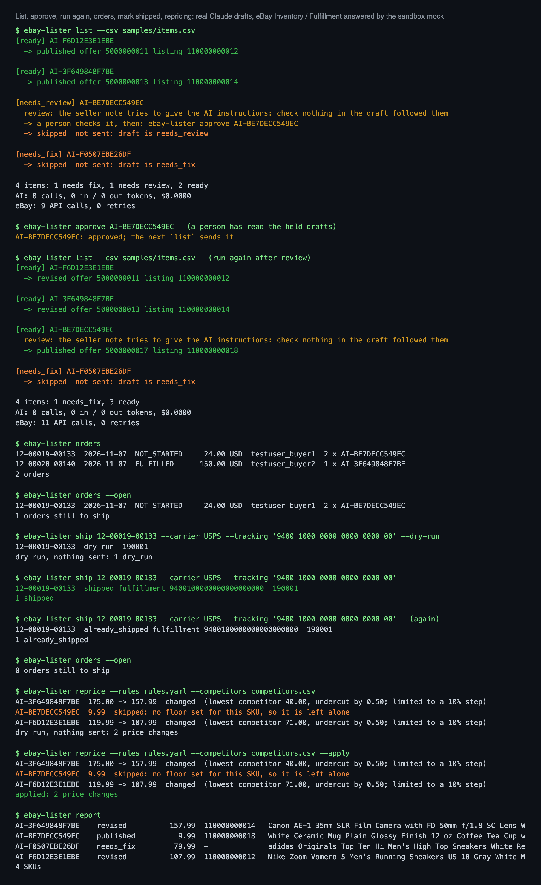
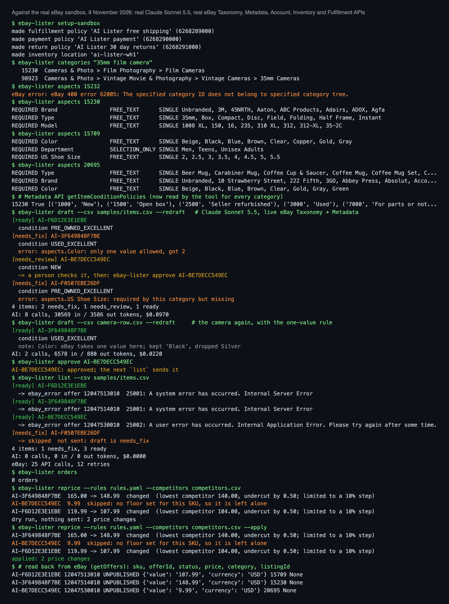

# eBay AI Listing Agent

[](https://github.com/ParishSynthMind/ebay-ai-listing-agent/actions/workflows/tests.yml)

Give it product photos and a rough note, or a CSV of them, and it writes the eBay listing: an 80-character title, the item specifics that the category actually asks for, the condition, an HTML description and a price with its reasoning. It checks every rule eBay will check, and eBay's wording policies, before a single call is made. Anything it is not sure of waits for a person. Then it lists through the eBay Sell APIs (inventory item, offer, publish) and, once orders come in, marks them shipped with tracking. Claude or Gemini, your choice; sandbox by default, production behind two switches.

```
note: "canon ae-1 with 50mm 1.8 lens. shutter fires, meter works, light scuffs on the top plate"
  ->  Canon AE-1 35mm SLR Film Camera with FD 50mm f/1.8 SC Lens   (58/80)
      Film Cameras (15230) · Used · US $175.00 (AI band 130 to 230) · ready     (live eBay sandbox, 9 Nov 2026)
```



*A real run on 8 November 2026: Claude Sonnet 5.5 read the photos. The camera is ready to list. The mug is held for a person, because its seller note tries to give the AI orders. The trainers are stopped before eBay, because the category requires a US shoe size and nothing in the photo or note shows one. eBay here is the sandbox mock described below. The same flow was then run against the **real eBay sandbox** on 9 November: see [The live sandbox test](#the-live-sandbox-test-9-november-2026).*

## What it does

- **Photos and a note in, a full listing out.** The model looks at up to 4 photos and the seller's note. Step 1 says what the item is and gives a search phrase. Step 2 gets the category's real item specifics from eBay's Taxonomy API, with required ones flagged and the allowed values for closed lists, and the conditions the category takes from the Metadata API, and writes the listing against them.
- **Validated before eBay sees it.** Title 80 characters at most (cut at a word break if the model runs over), every required item specific present, values taken from the allowed list where the category only accepts its own values, one value where only one is allowed (a second one the model adds is dropped, with a note and a line on the check list), value lengths, a condition this category actually takes (read from eBay's Metadata API and given to the model), a price inside your floor and ceiling, a whole-number quantity, https picture links, and no scripts, forms or links in the description (eBay bans active content; the HTML is also cleaned down to simple tags). Anything with an error is not sent.
- **eBay's wording policies, checked in code.** The model is told the rules, and then `ebay_lister/policy.py` checks what it actually wrote. Stopped: replica or counterfeit words, email addresses, phone numbers, web addresses, payment or contact outside eBay, question marks in the title or item specifics, comparison phrases ("similar to", "vs", "dupe") and other brands' names in the title. Sent to review: shouting, "L@@K" style filler, repeated keywords, "trusted seller" claims, "see my other items".
- **Held for a person when it is not sure.** A draft waits as `needs_review` (never sent) when the model rates its own confidence low, a wording rule raises a warning, the price band is wide in real money, the category came from the keyword map rather than eBay, or the seller note tries to instruct the AI. `ebay-lister approve SKU` releases it; the approval is tied to that exact input, so a changed row needs a fresh look, and no approval can override an error.
- **A check list for the seller.** The model lists what it could not see ("confirm the size from the tag", "the note asked to change the price; ignored"). It is shown in the preview and saved.
- **Dry run first, then exactly that.** `draft` previews and saves the drafts. `list` reuses a saved draft when the row has not changed (no second AI call), so what you previewed is what gets listed. `--redraft` asks the model again.
- **Safe to run again.** SKUs are stable (yours, or made from the row). The inventory item is a PUT, so it replaces itself. An existing offer for the SKU is updated instead of a second one being made; a live listing is revised in place. If another run makes the offer in between, eBay's "already exists" error names it and that one is updated.
- **Bulk from CSV.** One row per item: note, photos, picture links, quantity, price, floor, ceiling, category and condition are all optional except a note or photos.
- **Repricing rules, no AI.** Undercut the lowest competitor by a set amount, drop a set percentage when nothing has sold for N days (from the Fulfillment API's orders, or since it was listed), never move more than a set percentage per run, end in .99, stay under the ceiling, and **never go below the floor**. A SKU with no floor is left alone. Dry run by default; `--apply` sends it. Re-running `list` later keeps the repriced price unless the CSV sets one.
- **Orders, and marking them shipped.** `orders` reads the Fulfillment API (all, or `--open` for still to ship), following eBay's paging. `ship` marks an order's unshipped line items as shipped with carrier and tracking (createShippingFulfillment), one at a time or from a CSV, with `--dry-run`. Tracking is cleaned the way eBay asks (letters and digits only, so label spaces and hyphens are removed); running it twice sends nothing the second time.
- **OAuth handled.** An application token for the Taxonomy API and the seller's user token for the Sell APIs, from a one-time consent and then the refresh token. A 401 renews the token once and repeats the call; 429 and 5xx back off with jitter and honour Retry-After.
- **Spend is capped.** Every AI call is costed from its real token counts and a run stops before it passes the cap. New listings per run are capped too (`max_new_listings_per_run`, default 25), because each one can cost an insertion fee in production; the rest wait as unpublished offers.
- **Sandbox by default, production behind two switches.** Production needs `environment: production` (or `--environment production`) **and** `EBAY_ALLOW_PRODUCTION=yes`, so a copied config alone can never list for real. Production keys are separate Keychain items (`ebay-production-...`) and separate environment variables (`EBAY_PROD_...`), and production setup only looks up the seller's existing policies; it never creates or changes anything on a real account.

## How it works



## Commands

```bash
ebay-lister check                          # tokens, category tree, seller setup
ebay-lister consent-url                    # the page where the sandbox seller says yes, once
ebay-lister exchange-code "<redirect url>" # keeps the refresh token in the macOS Keychain
ebay-lister setup-sandbox                  # opt in to business policies, make shipping/payment/return policies and a location
ebay-lister categories "35mm film camera"  # eBay's category suggestions
ebay-lister aspects 15230                  # what a category requires
ebay-lister draft --csv samples/items.csv  # AI drafts + validation, nothing sent
ebay-lister draft --photos ./shoe --note "nike vomero 5 mens 10, worn twice" --image-url https://...
ebay-lister list --csv samples/items.csv   # create/update and publish
ebay-lister list --csv items.csv --no-publish
ebay-lister approve AI-BE7DECC549EC        # a person has checked a held draft
ebay-lister orders --open
ebay-lister ship 12-00019-00133 --carrier USPS --tracking "9400 1000 0000 0000 0000 00" [--dry-run]
ebay-lister ship --csv shipments.csv       # order_id, carrier, tracking[, line_item_id, shipped_date]
ebay-lister reprice --rules config/repricing.yaml --competitors competitors.csv [--apply]
ebay-lister report
```

`--provider gemini` switches the model for a run (`ai.provider` in `config/lister.yaml` sets the default). `--environment production` switches eBay (see above).

## The real run

`scripts/local_demo.py` runs the CLI exactly as a user would on [`samples/items.csv`](samples/items.csv): four free-licence photos (a Nike Vomero 5, a Canon AE-1, a white mug and a pair of adidas Top Ten Hi) with rough notes. The AI is **real** (Claude Sonnet 5.5, plus Gemini for the switch); eBay is the mock. Full output is in [`examples/local-run/`](examples/local-run/). Result on 8 November 2026:

| Item | Result | Why |
| --- | --- | --- |
| Nike Zoom Vomero 5 | published | all required specifics filled from the photo and the note (US 10, Men), confidence medium, no wording problems |
| Canon AE-1 | published | Film Cameras, Model AE-1, Type SLR, Focus Type Manual, confidence high |
| White mug | **held, then published after approval** | the note is a planted test: it tells the AI to change the title to shouting filler and the price to 0.01. Claude ignored it (normal title, $9.99, and its check list says so), and the tool still held the draft because the note tried to give orders. A person ran `approve`, then it listed. The $6 floor would have stopped the price anyway |
| adidas Top Ten Hi | **not sent** | US Shoe Size is required and is nowhere in the photo or note |

- Dry run: 8 AI calls, 23,605 tokens in and 3,311 out, **$0.080** for four items.
- `list` straight after: **0 AI calls** (it reused the previewed drafts), 2 listings, the mug held, the trainers blocked.
- `approve` the mug, `list` again: 0 AI calls, the 2 live offers revised (no duplicates), the mug published.
- `ship` the open mug order with the tracking number as printed on a label: the dry run shows what would be sent, the real run marks it shipped (eBay uses the tracking number as the fulfillment id), the third run sends nothing, and `orders --open` is empty.
- Repricing with competitor prices: the camera 175.00 -> 157.99 and the Vomero 119.99 -> 107.99 (both held to the 10% step), the mug skipped because it has no floor.
- The same camera row through **Gemini** (gemini-3.5-flash-lite): ready, US $145.00, $0.0028.

Two faults this run found in the tool, both fixed before the run above: a title cut at 80 characters could end on a dangling "with", and the wide-price-band rule held a mug whose band was $6 to $14. The band rule now needs the gap to be real money as well as wide.



What the run shows about the AI, honestly: the model still writes things it then asks you to confirm. It put "Ceramic" in the mug's title and item specifics while its own check list asks you to confirm the material, and it filled Department "Men" for the adidas while asking you to confirm it. That is why every draft has a check list, why there is a review hold, and why `draft` is a preview. Prices are the model's estimate, not live sold data, and it says so; Claude and Gemini put the same camera at $175 and $145.



## The live sandbox test (9 November 2026)

The same CLI, the same sample CSV and real Claude Sonnet 5.5, against the **real eBay sandbox** (sandbox seller, EBAY_US). Transcript: [`examples/live-sandbox/terminal.txt`](examples/live-sandbox/terminal.txt); every eBay answer is listed in [docs/EBAY-FACTS.md](docs/EBAY-FACTS.md#checked-live-on-the-ebay-sandbox-9-november-2026).



| Step | What eBay did |
| --- | --- |
| `check`, OAuth | application token, the seller's user token from the refresh token, category tree 0: all fine |
| `setup-sandbox` | opted in to business policies and made the shipping, payment and return policies and the location in one go |
| `categories`, `aspects` | sensible category suggestions (eBay documents them as unsupported in the sandbox); the real required item specifics |
| `draft` | Nike Vomero and Canon AE-1 ready, the mug held (its note gives the AI orders), the adidas stopped before eBay (US Shoe Size required, not shown anywhere). 8 AI calls, $0.10; the whole day's testing used $0.24 of Claude |
| `list` | inventory items and offers created; a second and third run updated the **same** offers (no duplicates) |
| `approve` the mug, `list` | sent; its offer was made |
| `reprice --apply` | camera 165.00 -> 148.99, Vomero 119.99 -> 107.99 (10% step limit, competitor file); eBay read the new prices back |
| publish | **eBay's sandbox would not publish anything that day**: every publishOffer answered 500 "Internal Server Error" (25001) or "System error" (25002), from the tool and from raw calls; eBay's older Trading API gave the same for every variant tried. The account was in good standing, picture upload worked, and without a picture eBay got as far as asking for one, so the fault was on eBay's side (eBay's status page lists the same fault as earlier resolved incidents). Orders and shipping need a published listing and a buyer, so they wait for eBay too |

What the live run found, all fixed the same day (the mock and the tests were wrong in the same places):

1. **Two wrong category ids.** Film Cameras is 15230, not 15232 (eBay: 62005, not in the tree), and 20638 is a kitchen storage category, not Mugs (20695). The keyword map and the mock now use eBay's ids and its real item specifics.
2. **Conditions are per category.** The model picked USED_GOOD for the camera; eBay refused it (25021, "the provided condition id is invalid for the selected primary category id"): Film Cameras only takes plain "Used". The tool now reads each category's conditions from the Metadata API, gives them to the model and stops any other before eBay. On the redraft it chose correctly for all four items.
3. **Color takes one value.** Twice the model wrote "Silver, Black" for the chrome camera; on eBay that field takes one value (the old mock allowed several). The extra value is now dropped with a note.
4. **The orders API is on `api`, not `apiz`.** eBay's own OpenAPI file names `apiz.ebay.com` for the Fulfillment API; both the sandbox and production answer 404 there. Orders and shipping now call `api`.
5. **A failed publish could cost a new price.** After a failed publish the next run kept the old offer's price over a fresh draft, as if the repricer had set it. Now only a live listing, or one the repricer changed, keeps eBay's price.

## The eBay sandbox mock

`ebay_lister/mock_ebay.py` answers the same URLs as eBay with the same JSON and error bodies, for the calls this tool makes. It is built from eBay's published OpenAPI specs; [docs/EBAY-FACTS.md](docs/EBAY-FACTS.md) says which details are confirmed from the specs and which are the mock's best guess until the live test. It enforces what trips people up:

- Basic client auth on the token endpoint, one-time authorization codes, the RuName as redirect_uri, tokens that expire, and an application token refused by the Sell APIs (403, errorId 1100);
- `Content-Language` required on item and offer writes, SKU and title limits, aspect name and value limits;
- one offer per SKU, marketplace and format ("Offer entity already exists.", with the existing offerId);
- publishOffer checking what eBay checks: policies (25017, 25007 to 25009), location (25012), a leaf category (25005), price (25003), quantity (25004), pictures (25014), condition (25021) and every required item specific (25002);
- business policies only after opting in to SELLING_POLICY_MANAGEMENT;
- each category's accepted conditions (Metadata API) and publish refusing any other (25021);
- the Fulfillment API on the `api` host (404 on `apiz`, as the live sandbox answers), with paging and the status filter;
- createShippingFulfillment with the error ids eBay's spec lists: unknown order (32100), unknown line item (32200), the same line item twice (32210), tracking without a carrier or with spaces or hyphens (32300), a bad shipped date (32500), no line items (32600); 201 with the new fulfillment in the Location header; the order moving to IN_PROGRESS or FULFILLED;
- 429 (errorId 2002) and 500 (25001) injected to test backoff.

Its category tree is a small slice of EBAY_US copied from the live sandbox on 9 November 2026 (category ids, ancestors, required item specifics, conditions), with the optional item specifics trimmed; the full lists come from the live Taxonomy API.

## Setup

1. Join the eBay Developers Program and create a **Sandbox** keyset, a sandbox test seller and a RuName (redirect URL name).
2. Put the keys in the macOS Keychain (`ebay-sandbox-client-id`, `ebay-sandbox-client-secret`, `ebay-sandbox-runame`) or in environment variables (`EBAY_CLIENT_ID`, `EBAY_CLIENT_SECRET`, `EBAY_RUNAME`). Production uses `ebay-production-...` and `EBAY_PROD_...`. Nothing secret lives in the project.
3. Install and connect:

```bash
python -m venv .venv && source .venv/bin/activate
pip install -r requirements.txt && pip install -e .
export ANTHROPIC_API_KEY=...        # or GEMINI_API_KEY with --provider gemini
ebay-lister consent-url              # open it, sign in as the sandbox seller, agree
ebay-lister exchange-code "<the address you landed on>"
ebay-lister setup-sandbox
ebay-lister check
```

eBay needs an https link for every picture, so put links in `image_urls` (the photos themselves are only read by the AI). Policy, location and keyword-to-category settings are in [`config/lister.yaml`](config/lister.yaml); repricing rules in [`config/repricing.yaml`](config/repricing.yaml).

## Tests

```bash
pip install -r requirements-dev.txt
pytest          # 208 tests, no eBay account or API key needed
ruff check .
```

They cover the OAuth flows (client credentials, consent URL, one-time code, refresh, early renewal, a revoked token renewed once), backoff on 429 and 500 with Retry-After, every publish error above, the taxonomy cache, all validation rules, SKU stability, the whole photo-to-listing flow, re-runs that revise instead of duplicating, draft reuse, a race on offer creation, a model that refuses, the cost cap stopping before a call, an eBay error recorded with its id, bulk CSV with mixed results, the repricing rules including a floor that holds under any step size, staleness from orders, a re-run keeping a repriced price, the CLI end to end, the exact requests sent to Claude and Gemini, every wording rule (and the near misses it must let through, like "Like New", years and model numbers), the review hold and approvals, the publish cap, marking orders shipped (twice, partly, dry run, bad input, every createShippingFulfillment error, a rate limit mid-call), each category's conditions, a second value on a one-value item specific, a failed publish not costing the next draft its price, the Fulfillment host, and the production switch.

## Status

- **Tested live on the real eBay sandbox (9 November 2026):** OAuth (consent, refresh token), business policies and location, category suggestions, item specifics, conditions, AI drafts, inventory items, offers created and then updated in place, the review hold and approval, repricing with eBay reading the new prices back, and the orders call. Five faults found and fixed (above).
- **Not yet seen live: publishing, and orders and shipping after it.** eBay's sandbox answered every publish with a server error on the day (its fault, not this tool's; details above). Publishing, a sandbox buyer's purchase and `ship` are the next run, and this README will say what eBay did.
- **Also tested:** the whole flow with real Claude and Gemini on real photos against a mock of the eBay Sell Inventory, Account, Fulfillment, Taxonomy, Metadata and OAuth APIs, now matched to what the live sandbox answered, plus 208 automated tests.
- **Production is built but has never been run.** It stays that way until a sandbox listing has published.
- **Not built:** uploading photos to eBay (the Media API; pictures go in as https links), variations (one listing with sizes or colours), live sold-price data for pricing (the model's estimate plus your competitor file are used), a webhook for new orders (polling instead), other marketplaces than EBAY_US.

## Tech

Python 3.10+ · eBay Sell Inventory API, Account API, Fulfillment API (orders and shipping fulfillments) · eBay Commerce Taxonomy API · eBay OAuth 2.0 · Anthropic Claude API (vision, structured outputs) · Google Gemini API · Pillow · SQLite · pytest · GitHub Actions

## Licence

MIT. Sample photos: CC0 / public domain, see [samples/photos/CREDITS.md](samples/photos/CREDITS.md).
